# Конспект лекции: большие данные, от HDFS до Lakehouse

Лекция обзорная: мы не писали код, а шли по схемам и собирали стек больших данных слой за слоем. Порядок такой: сначала понимаем проблему, потом идеи, которые её решают, и только потом конкретные инструменты. Каждый инструмент закрывает свою проблему.

> [!info] Команда с титульного слайда
> `spark-submit --master yarn daily_revenue.py`
> К концу конспекта каждое слово в ней должно быть понятно: что такое Spark-джоб, что значит `--master yarn` и что делает сам скрипт.

- [[#1. Что такое большие данные]]
- [[#2. Почему одной машины мало]]
- [[#3. Что придумали: три идеи]]
- [[#4. Hadoop: HDFS, YARN, MapReduce]]
- [[#5. Hive и форматы хранения]]
- [[#6. Apache Spark и PySpark]]
- [[#7. Trino]]
- [[#8. ETL, батчи и Airflow]]
- [[#9. От озера данных к Lakehouse]]
- [[#10. Весь стек на одной схеме]]
- [[#11. API и стек больших данных]]
- [[#Шпаргалка]]
- [[#Вопросы для самопроверки]]

## 1. Что такое большие данные

Классическое определение даётся через три V:

| V | Что значит | Где ломается |
|---|---|---|
| **Volume**, объём | терабайты и петабайты: логи, клики, транзакции за годы | не влезает на один диск |
| **Velocity**, скорость | данные приходят непрерывно, тысячами событий в секунду | не успеваем обработать |
| **Variety**, разнообразие | таблицы, JSON, логи, тексты, картинки, у каждого своя схема | не ложится в одну таблицу |

Иногда добавляют четвёртую V, **Veracity**, достоверность: данные грязные, с дублями и ошибками.

> [!important] Главное определение
> Граница не в гигабайтах. Данные **большие**, когда один сервер не может их сохранить или обработать за нужное время.

Каждый порядок величины меняет инструменты (цифры условные):

| Объём | Чем работаем |
|---|---|
| 1 ГБ | ноутбук: Excel, pandas, всё в памяти |
| 100 ГБ | один сервер: PostgreSQL с индексами |
| 10 ТБ | сервер ещё живёт, но полный проход по данным идёт часами |
| 1 ПБ и больше | только кластер из многих машин |

Порог зависит и от требований ко времени ответа. Отчёт раз в месяц терпит часы, антифрод не терпит и секунды. Та же сотня гигабайт может оказаться «большой», если ответ нужен за секунду.

## 2. Почему одной машины мало

### Главное узкое место: диск

Обычный жёсткий диск читает последовательно примерно 150–200 МБ/с. Посчитаем:

- 1 ТБ = 1 000 000 МБ;
- 1 000 000 МБ ÷ 200 МБ/с = 5 000 с ≈ **1,5 часа**, и это только чтение, без обработки;
- те же данные на **100 дисках**, читаем все одновременно: 50 с ≈ **1 минута**.

Объёмы дисков за последние десятилетия выросли в тысячи раз, а скорость чтения намного меньше. SSD быстрее, но картина та же, просто сдвигается порог. Из этой арифметики вырастает весь Hadoop: читать и считать надо параллельно на многих машинах.

### Шесть проблем

Первые три — пределы одной машины:

1. **Хранение.** Данные не влезают на один диск, а большой сервер стоит непропорционально дорого.
2. **Чтение.** Скорость диска растёт медленнее объёмов, полный проход идёт часами.
3. **Вычисления.** CPU и памяти одной машины не хватает, pandas падает с `MemoryError`.

Вторые три появляются, как только мы берём много машин:

4. **Отказы.** На тысячах машин диски и серверы ломаются каждый день, это норма, а не авария.
5. **Сеть.** Везти терабайты к вычислителю по сети дольше, чем считать.
6. **Схема и качество.** Форматы разные, схема меняется, дубли и мусор неизбежны.

Весь стек больших данных — это ответы на эти шесть пунктов.

## 3. Что придумали: три идеи

### Идея 1. Горизонтальное масштабирование

| | Scale up: сервер мощнее | Scale out: больше машин |
|---|---|---|
| Как | 8 → 32 → 128 CPU в одном сервере | добавляем обычные дешёвые узлы |
| Плюсы | просто, код менять не нужно | растём почти линейно, отказ одной машины не страшен |
| Минусы | есть потолок, цена растёт быстрее мощности, одна точка отказа | нужен софт, который распределит данные и задачи |

Этот софт и есть Hadoop, а позже Spark.

### Идея 2. Код едет к данным (data locality)

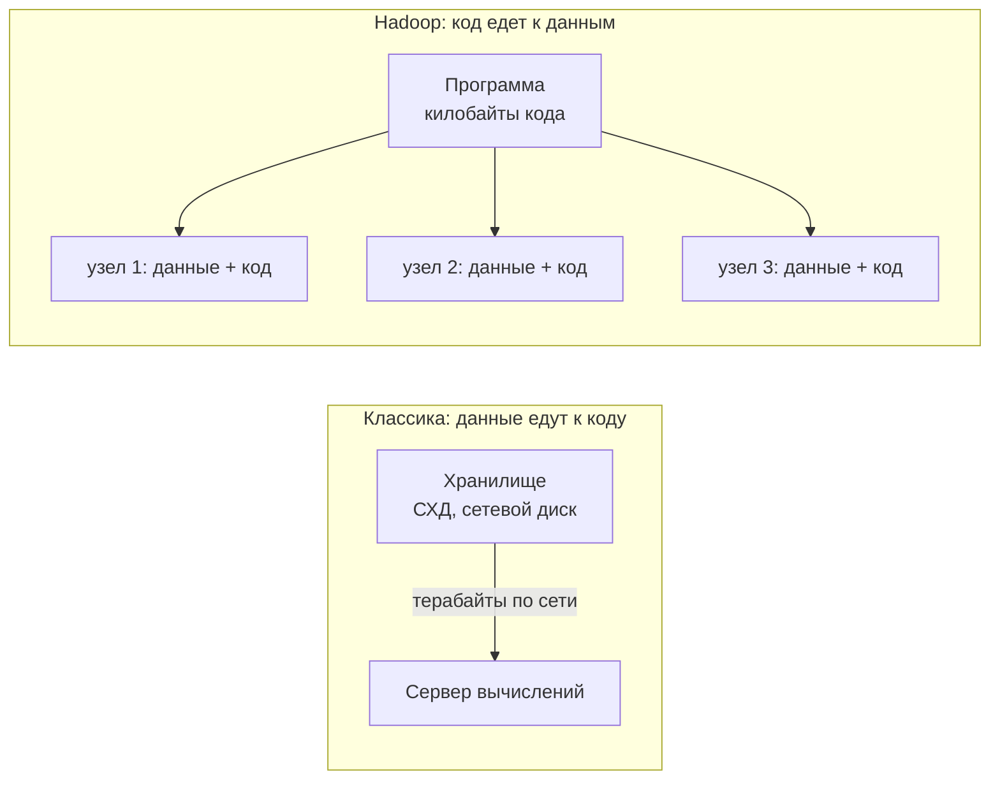

Сеть 10 Гбит/с — это примерно 1,25 ГБ/с. 10 ТБ будут ехать больше двух часов, и это в идеальном случае. Программа весит килобайты, поэтому выгоднее отправить код на узлы, где уже лежат нужные куски данных. Каждый узел читает свой кусок с локального диска, а по сети едут только код и небольшие результаты.

### Идея 3. Надёжность через копии

Раз машины дешёвые и ломаются, надёжность обеспечиваем не дорогим железом, а копиями данных на разных машинах. Это увидим в HDFS.

## 4. Hadoop: HDFS, YARN, MapReduce

Hadoop — не одна программа, а платформа из трёх слоёв:

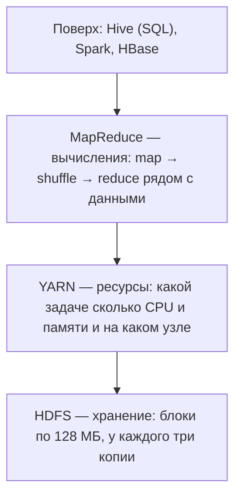

История: Google публикует статьи про файловую систему GFS (2003) и MapReduce (2004). Дуг Каттинг с командой в Yahoo делает открытую реализацию, около 2006 года это становится Hadoop. Сегодня HDFS и YARN живы, а MapReduce почти везде заменён Spark.

### HDFS: блоки и реплики

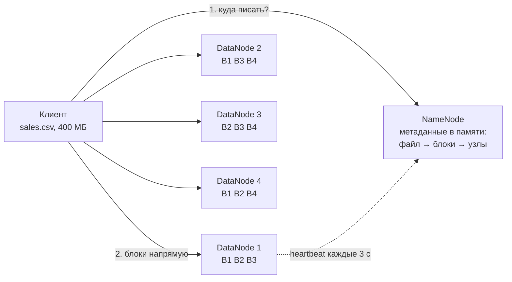

- Файл режется на **блоки по 128 МБ**. Файл 400 МБ — это три полных блока и последний на 16 МБ. Последний блок не занимает лишнего места: 16 МБ так и лежат как 16 МБ.
- У каждого блока **3 реплики** на разных DataNode. 4 блока × 3 = 12 блоков на кластере.
- **NameNode** хранит только метаданные: из каких блоков состоит файл и где лежит каждый блок. Сами данные через NameNode не проходят.
- **DataNode** хранят блоки на своих дисках. Каждые 3 секунды шлют NameNode heartbeat и периодически полный список своих блоков.

**Запись** идёт конвейером. NameNode выбирает три узла, клиент отдаёт блок первому, тот сразу пересылает второму, второй — третьему. Подтверждения возвращаются по цепочке назад.

**Rack awareness.** Первая копия обычно на узле рядом с клиентом, вторая и третья — в другой стойке. Если отключится целая стойка (упал коммутатор или питание), у блока останется копия.

**Чтение.** NameNode отдаёт список узлов для каждого блока, клиент читает с ближайшей копии. Разные блоки читаются параллельно с разных узлов, отсюда скорость.

**Отказ узла** — штатная ситуация. Heartbeat пропал, узел считается мёртвым, NameNode видит, что у части блоков меньше трёх копий, и досоздаёт их на других узлах. Клиенты этого не замечают.

> [!warning] Записали один раз, читаем много
> В HDFS можно дописать в конец файла, но нельзя поменять байты в середине. Это всплывёт, когда дойдём до UPDATE и DELETE в Lakehouse.

> [!question]- Что будет, если упадёт NameNode?
> В старых версиях это была единая точка отказа. Сейчас ставят пару Active/Standby NameNode с общим журналом изменений и автоматическим переключением.

> [!question]- Почему блок 128 МБ, а не 4 КБ, как в обычной файловой системе?
> Чтобы метаданных было мало и они помещались в памяти NameNode, а чтение было длинным и последовательным. Обратная сторона — **проблема мелких файлов**: миллион файлов по 1 КБ забивает память NameNode.

### YARN

YARN распределяет ресурсы кластера: у какой задачи сколько ядер и памяти и на каком узле она запустится. Им пользуются и MapReduce, и Spark.

### MapReduce: считаем слова

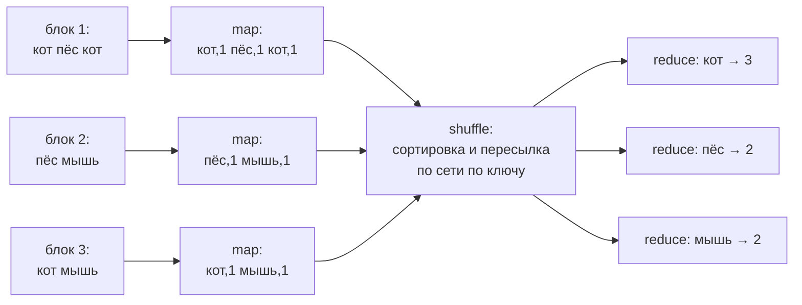

1. **Map** запускается на каждом блоке на том же узле, где лежит блок. Для каждого слова выдаёт пару «слово, 1».
2. **Shuffle** сортирует пары и пересылает их по сети так, чтобы все пары с одним ключом попали на один reducer. Это самый дорогой шаг: единственный, где данные массово едут по сети.
3. **Reduce** получает ключ и список значений и сворачивает их, здесь суммирует.

Программист пишет только функции map и reduce. Распределение, перезапуск упавших задач и пересылку данных делает фреймворк.

**Главный минус:** после каждого шага результат пишется на диск в HDFS. Реальные задачи — это цепочки из многих джобов, и цепочка из 10 джобов означает 10 раз записать и прочитать всё с диска. Именно это и починил Spark.

## 5. Hive и форматы хранения

### Hive: SQL поверх файлов

Hive появился в Facebook около 2008 года: аналитики знали SQL, а писать MapReduce на Java не хотели.

```sql
CREATE EXTERNAL TABLE sales (
  order_id BIGINT,
  amount   DECIMAL(10,2)
)
PARTITIONED BY (dt STRING)
STORED AS PARQUET
LOCATION '/warehouse/sales';

SELECT dt, SUM(amount)
FROM sales
WHERE dt = '2026-11-08'
GROUP BY dt;

-- на диске это просто файлы:
-- /warehouse/sales/dt=2026-11-08/part-0.parquet
```

Путь запроса:

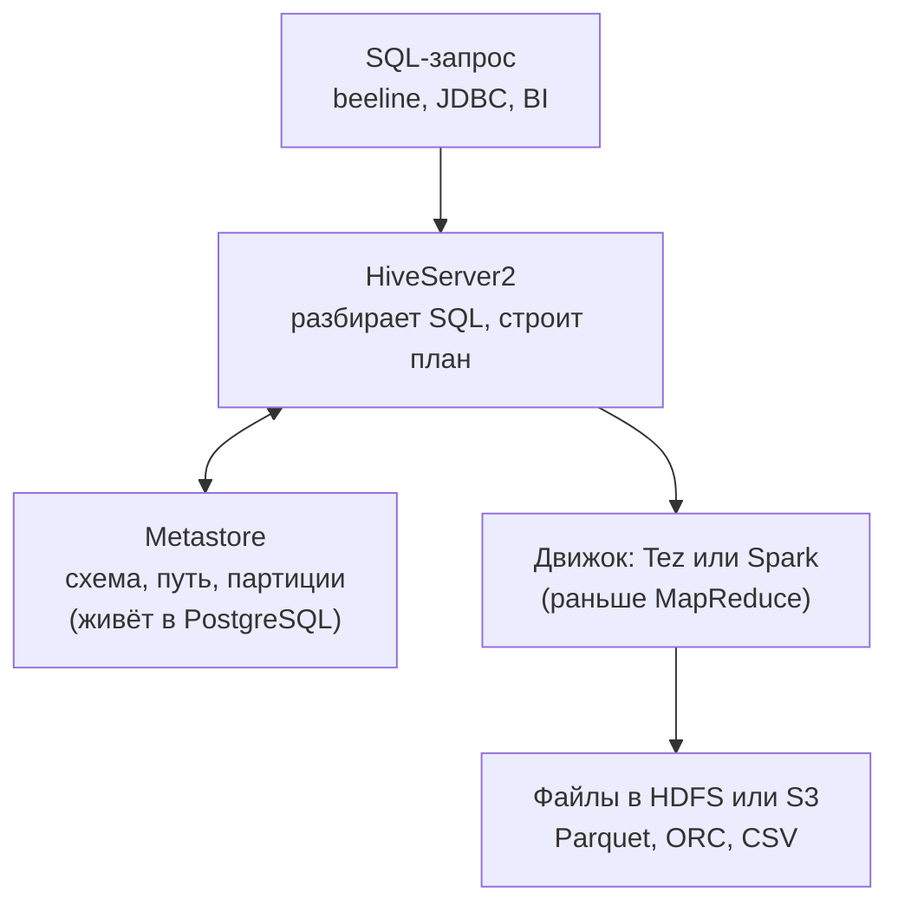

- Данные остаются обычными файлами. Hive отдельно хранит **описание таблицы**: колонки, путь к файлам, формат, партиции. Описание живёт в **Metastore**, а Metastore — это обычная реляционная база (PostgreSQL или MySQL).
- **Schema-on-read:** схема применяется при чтении, а не при записи. Файл можно положить в папку любым способом, и он сразу станет частью таблицы.
- `EXTERNAL`: при `DROP TABLE` удалится только описание, файлы останутся.
- Самое ценное, что пережило Hive, — **Metastore**. Его используют как каталог таблиц Spark, Trino и другие движки.

### Строки, колонки и партиции

**Построчные форматы** (CSV, JSON): на диске подряд лежат целые строки. Чтобы посчитать `SUM(amount)`, нужно прочитать все колонки всех строк: 9 из 9 ячеек в примере на слайде.

**Колоночные форматы** (Parquet, ORC): подряд лежат значения одной колонки. Запрос читает только `amount`: 3 из 9 ячеек. Аналитические запросы обычно трогают 3–5 колонок из десятков, поэтому выигрыш в разы. Бонусы:

- одинаковые значения подряд хорошо сжимаются;
- в метаданных файла хранятся min и max по каждому куску, и движок пропускает куски, где точно нет нужных значений (**predicate pushdown**).

**Партиционирование:** данные раскладываются по папкам, обычно по дате. Запрос с фильтром по дате открывает одну папку из сотен:

```text
/warehouse/sales/
├── dt=2026-11-07/part-0.parquet
├── dt=2026-11-08/part-0.parquet   ← WHERE dt = '2026-11-08'
└── dt=2026-11-09/part-0.parquet
```

Типичный набор для больших данных — Parquet плюс партиции по дню. Для OLTP-базы вроде PostgreSQL построчное хранение правильное: там читают и пишут целые строки по одной.

> [!question]- Почему обычно берут Parquet, а не ORC?
> Технически они почти равны: оба колоночные, со сжатием, статистикой и predicate pushdown. В Hive и Trino ORC местами даже быстрее, а Hive ACID исторически работает только на ORC. Parquet выиграл экосистемой: это формат по умолчанию в Spark, его нативно читают pandas/Arrow, DuckDB, Polars и облачные сервисы, Delta Lake работает только с Parquet, Iceberg пишет в Parquet по умолчанию. «Лучше» здесь значит «стандарт де-факто», а не «быстрее».

## 6. Apache Spark и PySpark

Spark вырос в лаборатории AMPLab в Беркли около 2009 года и стал проектом Apache в 2013–2014.

### Почему Spark быстрее MapReduce

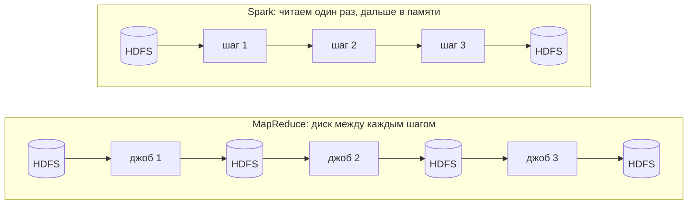

- **В памяти.** Spark строит всю цепочку целиком и передаёт данные между шагами в памяти executors. На диск пишется итог, а также данные shuffle и то, что не влезло в память. Для одной простой агрегации выигрыш небольшой, для цепочек и итеративных алгоритмов (ML) — огромный.
- **Один движок** для батча, SQL, стриминга и машинного обучения.
- **Удобный API:** DataFrame и SQL на Python, Scala, Java вместо ручных map и reduce.

> [!warning] Spark работает «только в памяти»?
> Нет. Если данные не влезают, Spark сбрасывает часть на диск (spill) и продолжает работать, а shuffle всегда пишет промежуточные файлы. Правильнее так: Spark не пишет в HDFS между шагами и держит данные в памяти, когда может.

### Как устроено Spark-приложение

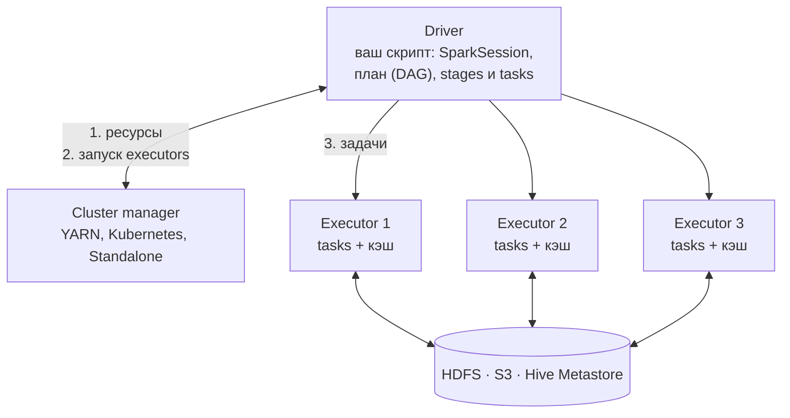

- **Driver** — процесс, где выполняется ваш скрипт. Он создаёт `SparkSession`, строит план, режет его на stages и tasks, раздаёт задачи и собирает результаты.
- **Executors** — рабочие процессы JVM на узлах кластера. Выполняют tasks и держат кэш.
- **Cluster manager** выдаёт ресурсы под executors: YARN в мире Hadoop, всё чаще Kubernetes, Standalone. Для ноутбука есть локальный режим `local[*]`.
- Одна **task** обрабатывает одну партицию данных, поэтому параллелизм определяется числом партиций.

> [!important] Как Spark связан с Hadoop
> Spark не заменяет Hadoop целиком. Он заменяет **MapReduce** как движок вычислений, а хранение в HDFS, ресурсы через YARN и таблицы из Hive Metastore может использовать как есть. Отсюда команда `spark-submit --master yarn`: отправить скрипт, ресурсы даст YARN.

### Ленивые вычисления: сначала план, потом запуск

```python
df = spark.read.parquet("/raw/orders")           # только план
paid = df.filter(df.status == "paid")            # только план
by_day = paid.groupBy("dt").sum("amount")        # план, будет shuffle
by_day.write.parquet("/marts/by_day")            # действие: запуск
```

- **Трансформации** (`filter`, `select`, `join`, `groupBy`) только дописывают план, граф операций (DAG). Ничего не читается и не считается.
- **Действия** (`count`, `show`, `collect`, `write`) запускают job. Spark видит план целиком, оптимизатор **Catalyst** его улучшает (например, переносит фильтр поближе к чтению) и запускает выполнение.
- Job делится на **stages** по границам shuffle. `read` и `filter` выполняются конвейером внутри одной партиции (узкие зависимости). `groupBy` требует собрать строки с одним ключом в одном месте (широкая зависимость, shuffle) — здесь граница stage.
- Каждый stage состоит из **tasks**, по одной на партицию. Всё это видно в Spark UI на порту 4040.

> [!tip] Практические советы
> Если в коде нет действия, ничего не произойдёт. Не вызывайте `collect()` на больших данных: он тащит всё в память driver.

### Один ETL-джоб на PySpark

```python
from pyspark.sql import SparkSession, functions as F

spark = SparkSession.builder.appName("revenue").getOrCreate()

orders = spark.read.parquet("/raw/orders/dt=2026-11-08")
clients = spark.read.parquet("/raw/clients")

revenue = (orders
    .filter(F.col("status") == "paid")
    .join(clients, "client_id")
    .groupBy("region")
    .agg(F.sum("amount").alias("revenue")))

(revenue.write.mode("overwrite")
    .parquet("/marts/revenue/dt=2026-11-08"))
```

То же на Spark SQL, после оптимизатора план будет одинаковым:

```sql
SELECT c.region, SUM(o.amount) AS revenue
FROM orders o
JOIN clients c USING (client_id)
WHERE o.status = 'paid'
GROUP BY c.region
```

Запуск: `spark-submit --master yarn job.py` на кластере или `--master local[*]` на ноутбуке.

На что обратить внимание:

1. Это обычный Python, но данных в нём нет. PySpark только описывает план, считает JVM на executors. Python-циклы по строкам и pandas внутри Spark-кода — антипаттерн: всё выражаем через функции DataFrame или SQL.
2. Spark даёт оба интерфейса, DataFrame API и SQL.
3. `mode("overwrite")` и дата в пути. Если джоб упадёт и его перезапустят, он перезапишет ту же партицию, а не добавит дубли. Это **идемпотентность**, она понадобится в Airflow.

> [!question]- Чем PySpark отличается от pandas?
> pandas держит данные в памяти одной машины и считает сразу. PySpark описывает план, а считают executors на кластере. Для знакомого синтаксиса есть `pyspark.pandas`.

## 7. Trino

В 2012 году в Facebook сделали **Presto**: Hive на MapReduce отвечал на аналитические запросы минутами и часами, а аналитикам нужно было интерактивно. В 2019 авторы ушли из Facebook и продолжили проект как форк, с 2020 года он называется **Trino**. Presto тоже живёт, на нём построен Amazon Athena.

### Как работает Trino

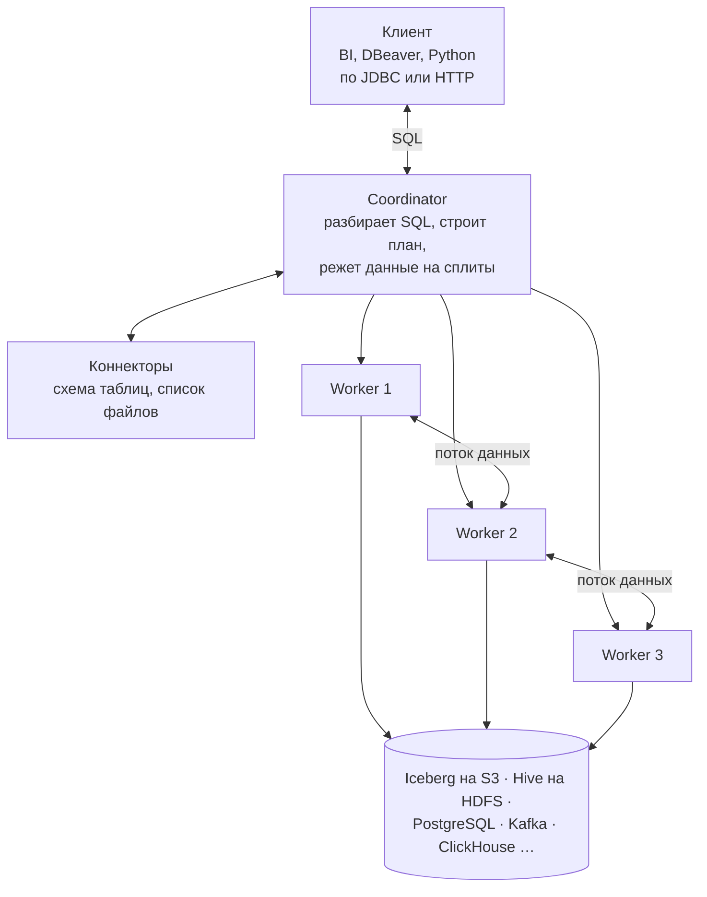

1. Клиент отправляет SQL на **coordinator**.
2. Coordinator через **коннекторы** узнаёт схему таблиц и список файлов, строит распределённый план и режет данные на **сплиты** (куски файлов).
3. **Workers** читают свои сплиты прямо из источников и обрабатывают их в памяти.
4. Между этапами данные идут **потоком, по сети от worker к worker**, без записи промежуточных результатов на диск. Первые строки результата могут прийти клиенту, пока остальное ещё считается.

Это архитектура **MPP** (massively parallel processing), как в классических аналитических СУБД.

**Своего хранилища у Trino нет.** Всё читается через коннекторы: Iceberg, Hive, PostgreSQL, Kafka, ClickHouse, MongoDB и десятки других. Каждый настроенный коннектор в Trino называется **каталогом**, и имя таблицы пишется в три части: `каталог.схема.таблица`. Отсюда **федерация**: в одном запросе можно соединить данные из разных систем.

```sql
SELECT c.region, sum(o.amount) AS revenue
FROM iceberg.dds.orders o
JOIN postgresql.public.clients c
  ON c.id = o.client_id
WHERE o.ts >= DATE '2026-11-01'
GROUP BY 1;
```

Это удобно для разовой аналитики. Для регулярных отчётов справочник лучше загрузить в озеро, чтобы не нагружать боевую базу сервиса.

> [!warning] Не путать два «каталога»
> Каталог в Trino — это настроенный коннектор (`iceberg`, `postgresql`). Каталог в Lakehouse (раздел 9) — это сервис, который хранит указатель на текущую версию таблицы. Слово одно, смыслы разные.

### Trino и Spark: разные профили нагрузки

Оба движка выполняют SQL по тем же таблицам. Это не «лучше и хуже», а разные компромиссы.

| | Trino | Spark |
|---|---|---|
| Сильная сторона | быстрый ответ, много запросов сразу | долгие тяжёлые джобы, сложная логика |
| Язык | только SQL | SQL, Python, Scala |
| Между этапами | поток в памяти по сети | shuffle с записью на диск |
| Упал узел | запрос перезапускают целиком | пересчитают только упавшие tasks |
| Как запущен | кластер работает постоянно | ресурсы поднимаются под джоб |
| Типичная задача | BI, ad-hoc SQL, витрины для API | ETL между слоями, ML, стриминг |

**Где Trino сильнее:**

- задержка: кластер уже поднят, нет записи на диск между этапами, ответ за секунды;
- параллельность: сотни одновременных запросов аналитиков и BI, ресурсы делятся через resource groups;
- федерация из коробки;
- обычный ANSI SQL по JDBC, BI подключается как к обычной базе.

**Где Spark сильнее:**

- многочасовые джобы доходят до конца, потому что упавшие tasks пересчитываются;
- Python, UDF, ML, стриминг;
- огромные джойны, которые не влезают в память.

У Trino для долгих запросов есть режим fault-tolerant execution, но это не основной сценарий.

> [!warning] «Spark пишет, Trino читает» — упрощение
> Spark тоже много читают: Spark SQL в ноутбуках, Thrift Server. Trino тоже пишет: `INSERT`, `CREATE TABLE AS`, `MERGE` в Iceberg, на нём часто гоняют dbt. Типичная картина такая: регулярный тяжёлый ETL на Spark, интерактивный SQL на Trino, но границы размыты.

## 8. ETL, батчи и Airflow

### Что такое ETL

Данные в компании живут в десятках систем: базы сервисов, внешние API, очереди, файлы. Аналитике и ML они нужны вместе, в одном месте и в удобном виде. **ETL** — процесс, который регулярно забирает данные из источников, приводит их в порядок и складывает в хранилище.

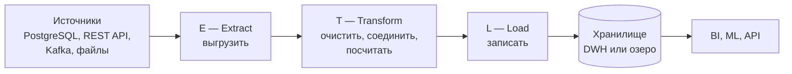

- **Extract:** выгрузить, например, вчерашние заказы из PostgreSQL сервиса заказов или курсы валют из REST API.
- **Transform:** убрать дубли, привести типы и форматы дат, соединить со справочниками, посчитать агрегаты. PySpark-джоб из раздела 6 — это и есть T и L.
- **Load:** записать результат в хранилище.

| | ETL | ELT |
|---|---|---|
| Порядок | преобразуем до загрузки, на отдельном движке | сначала грузим сырьё как есть, преобразуем внутри хранилища |
| Где типично | классические DWH: в хранилище попадает уже чистое | озёра и облака: хранение дешёвое, движки мощные |

Многие источники — это ровно те REST API, которые мы проектировали в курсе. Один из типичных потребителей готовых данных тоже API-сервис.

### Батч и стриминг

**Батч** (пакетная обработка): данные копятся, потом обрабатываются порцией по расписанию. Самый частый вариант: ночью обрабатываем всё, что пришло за вчера, то есть одну партицию `dt`.

Пример: в 02:00 девятого ноября джоб берёт всю партицию `dt=2026-11-08` и пересчитывает витрину. Сдвиг нужен, чтобы дождаться опоздавших событий, а ночью ещё и нагрузка на источники меньше.

| | Батч | Стриминг |
|---|---|---|
| Как | порциями по расписанию | каждое событие сразу |
| Задержка | минуты, часы, сутки | секунды и меньше |
| Примеры | ночные витрины, отчёты, признаки для ML | антифрод, алерты, онлайн-рекомендации |
| Инструменты | Spark, Hive, Airflow | Kafka, Flink, Spark Structured Streaming |

Правило выбора: если бизнесу достаточно данных за вчера, берите батч. Он проще и дешевле.

### Airflow: дирижёр, а не оркестр

Airflow появился в Airbnb в 2014 году, с 2019 это проект верхнего уровня Apache, актуальная ветка — Airflow 3.

> [!important] Airflow не обрабатывает данные
> Он знает, какие задачи есть, в каком порядке их запускать, по какому расписанию и что делать при ошибке. Сами данные считает Spark, база или другой сервис, который вызывает задача.

Типичный ежедневный пайплайн:

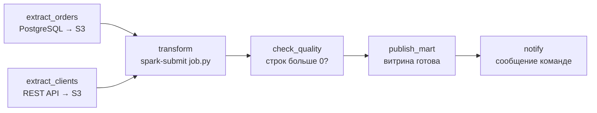

Две выгрузки идут параллельно, `transform` ждёт обе, потом проверка качества. Если проверка упала, витрина не обновится, и плохие данные никто не увидит.

Основные понятия:

- **DAG** — направленный граф задач без циклов, описанный кодом на Python.
- **Task** — шаг графа. **Operator** задаёт тип задачи: Python, Bash, SQL, Spark, HTTP.
- **DAG run** — один запуск графа за конкретный интервал данных.

Где применяется: ночные загрузки в хранилище, подготовка признаков и переобучение моделей, отчёты, выгрузки из внешних API, обслуживание таблиц.

> [!question]- Почему не cron?
> Cron не знает про зависимости между задачами, ретраи, историю запусков, бэкфилл и не даёт UI. Для одной задачи cron хватает, для сотни связанных — нет.

### Из чего состоит Airflow 3

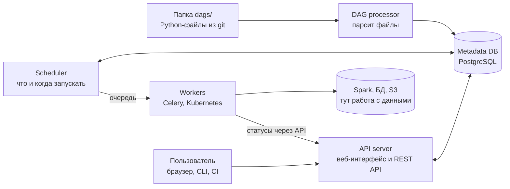

- **DAG processor** периодически читает файлы из `dags/` и сохраняет разобранные графы в базу. В Airflow 3 это обязательный отдельный компонент.
- **Metadata DB** (обычно PostgreSQL) хранит всё состояние: графы, запуски, статусы, историю.
- **Scheduler** смотрит на расписание и зависимости и отдаёт готовые задачи в очередь (Celery) или в поды Kubernetes.
- **Workers** выполняют задачи, а задачи уже обращаются к Spark, базам, S3. В Airflow 3 workers не ходят в базу напрямую, а сообщают статусы через API.
- **API server** даёт веб-интерфейс и полноценный REST API: через него можно запускать DAG, смотреть статусы, встраивать Airflow в другие системы.

Локально всё поднимается командой `airflow standalone` или через официальный docker-compose.

### Пайплайн — это Python-файл

```python
from datetime import datetime
from airflow.sdk import dag, task
from airflow.providers.apache.spark.operators import spark_submit

@dag(schedule="@daily", start_date=datetime(2026, 11, 1),
     catchup=False, default_args={"retries": 3})
def daily_revenue():
    @task
    def extract_orders(ds=None):   # ds = "2026-11-08"
        load_to_raw("orders", dt=ds)

    transform = spark_submit.SparkSubmitOperator(
        task_id="transform", application="jobs/revenue.py",
        application_args=["--dt", "{{ ds }}"])

    extract_orders() >> transform

daily_revenue()
```

`load_to_raw` здесь условная функция выгрузки. Тяжёлую работу делает не Airflow: `SparkSubmitOperator` отправляет Spark-джоб на кластер. Оператор `>>` задаёт порядок.

Три понятия важнее синтаксиса:

- **Logical date.** Запуск за 8 ноября стартует после окончания интервала, то есть 9-го, и обрабатывает данные 8-го. Дата доступна в шаблоне `{{ ds }}` и в аргументе `ds`. Частый источник путаницы.
- **Идемпотентность.** Повторный запуск задачи даёт тот же результат. Поэтому пишем в партицию за дату в режиме overwrite, а не дописываем в конец, иначе каждый перезапуск плодит дубли.
- **Retries и backfill.** Если источник временно недоступен, Airflow повторит задачу. Если поменяли логику или нашли ошибку, граф можно перезапустить за прошлые даты, это backfill. `catchup=False` значит, что при первом включении Airflow не будет догонять все дни с `start_date`.

> [!warning] Антипаттерн
> Грузить гигабайты в pandas внутри задачи Airflow или передавать данные между задачами через XCom. Между задачами передают пути к данным, а не сами данные.

## 9. От озера данных к Lakehouse

### Как пришли к Lakehouse

| Когда | Что | Суть |
|---|---|---|
| 1990-е | **DWH** | хранилище данных: SQL и транзакции, но дорого, закрыто и только таблицы |
| 2003–06 | **Hadoop** | статьи Google про GFS и MapReduce, открытый Hadoop |
| 2010-е | **Data Lake** | всё сырьё дёшево в HDFS, схема при чтении через Hive |
| 2014+ | **Spark и S3** | вычисления отделились от хранения, озёра переехали в объектные хранилища |
| 2020+ | **Lakehouse** | Iceberg, Delta Lake, Hudi: таблицы с транзакциями прямо в озере |

Каждый шаг чинил проблему предыдущего: дорогой DWH → хаос в озере → порядок в озере. Термин Lakehouse популяризировала Databricks около 2020 года.

### Идея: база данных, разобранная на части

В PostgreSQL хранение, журнал транзакций, каталог таблиц и движок запросов живут в одном процессе. В Lakehouse каждая часть отдельно:

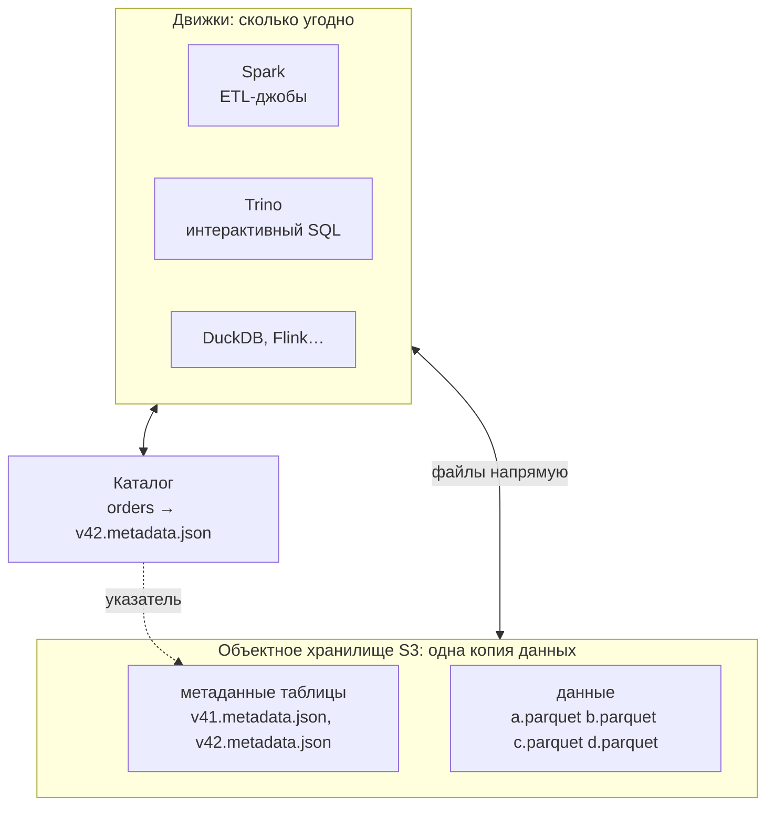

- **Хранилище** — S3, просто файлы. Данные лежат в Parquet.
- **Метаданные табличного формата** (например, Iceberg) лежат рядом: в них записано, из каких именно файлов состоит таблица в каждой версии.
- **Каталог** хранит одну вещь: для каждой таблицы указатель на актуальный файл метаданных.
- **Движки** — Spark, Trino, DuckDB и другие — работают с одной и той же копией данных, без выгрузок друг другу.

**Запись:**

1. Spark кладёт новый файл `d.parquet`. Пока его никто не видит: он не упомянут ни в одной версии.
2. Spark пишет новые метаданные `v42`, где перечислены a, b, c и d.
3. **Коммит:** Spark просит каталог переключить указатель с `v41` на `v42`. Каталог делает это атомарно. Если двое пишут одновременно, второй получит отказ и повторит попытку поверх новой версии (оптимистичная блокировка).

**Чтение:** Trino спрашивает каталог, получает `v42` и читает ровно те файлы, что там перечислены. Читатель всегда видит целую версию, никогда половину.

> [!question]- Если Spark в Kubernetes, а данные в S3, вычисления ведь на других машинах?
> Да, в современной схеме обычно так, и data locality из эпохи Hadoop теряется. Это осознанный обмен, и он окупается:
> - сети стали быстрыми, 25–100 Гбит/с;
> - Parquet, партиции и статистика Iceberg сильно сокращают объём, который реально читают;
> - у движков есть локальные кэши на SSD;
> - хранение и вычисления масштабируются и оплачиваются отдельно, кластер можно поднять на время джоба;
> - разные движки работают с одной копией данных.

### Apache Iceberg: таблица — это дерево метаданных

Iceberg появился в Netflix около 2017 года, когда им надоели проблемы Hive-таблиц на S3. Сейчас это проект Apache и фактический стандарт: его поддерживают Spark, Trino, Flink, DuckDB, Snowflake, BigQuery, AWS и многие другие.

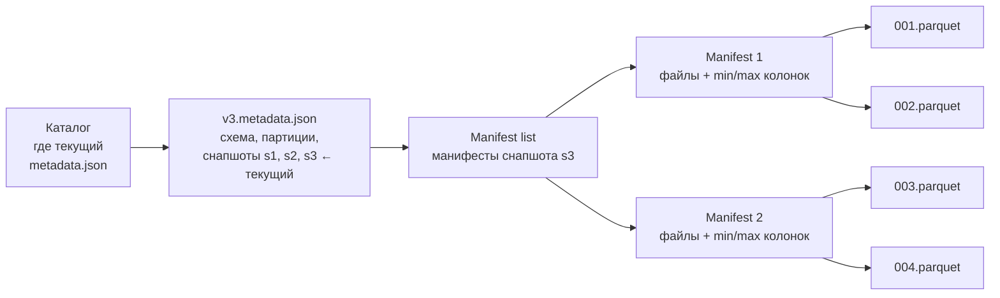

- **Каталог** знает только, где лежит текущий `metadata.json`.
- **metadata.json** — схема таблицы, правило партиционирования и список всех **снапшотов** (версий таблицы), с отметкой текущего.
- **Manifest list** — список манифестов, из которых состоит снапшот.
- **Manifest** — список data-файлов со статистикой по каждому: число строк, min и max каждой колонки, партиция.
- **Data files** — сами Parquet-файлы.

Зачем так сложно, а не просто папка:

1. **Транзакции.** Коммит — это новый `metadata.json` и атомарная смена указателя в каталоге.
2. **Быстрое планирование.** Не нужно листать папки в S3, где листинг миллиона файлов идёт минутами. Достаточно прочитать манифесты, а статистика min/max позволяет выкинуть файлы, где заведомо нет нужных строк.
3. **История.** Старые снапшоты продолжают указывать на свои файлы, поэтому можно прочитать таблицу на вчерашний день (**time travel**).

### Что происходит при изменении строк

Файлы в Lakehouse **никогда не меняются**. Если нужно поменять строки в одном файле, движок пишет новый файл одним из двух способов:

- **copy-on-write:** переписывает этот файл целиком уже с изменёнными строками;
- **merge-on-read:** пишет маленький delete-файл («строки 5 и 17 из файла X удалены») плюс файл с новыми версиями этих строк, а склеивание происходит при чтении.

Новый снапшот не копируется целиком. Пишутся только изменившиеся метаданные:

- новый манифест, где старый файл помечен удалённым и добавлен новый;
- новый manifest list, который ссылается на новый манифест и на все старые неизменённые манифесты;
- новый `metadata.json`.

Получается «предыдущий снапшот + diff», а общие части переиспользуются. Старый снапшот по-прежнему указывает на старый файл, поэтому работает time travel. Физически старые файлы удаляются только при чистке снапшотов процедурой `expire_snapshots`. Мелкие файлы периодически сливают процедурой `rewrite_data_files`, обычно отдельным DAG в Airflow.

### Iceberg на практике

Для пользователя это обычный SQL. Пример в Spark SQL, в Trino работает так же:

```sql
CREATE TABLE lake.dds.orders (
  id BIGINT, amount DECIMAL(12,2), ts TIMESTAMP)
USING iceberg PARTITIONED BY (days(ts));

MERGE INTO lake.dds.orders t USING updates u
ON t.id = u.id
WHEN MATCHED THEN UPDATE SET *
WHEN NOT MATCHED THEN INSERT *;

SELECT * FROM lake.dds.orders
TIMESTAMP AS OF '2026-11-08 00:00:00';

ALTER TABLE lake.dds.orders ADD COLUMN channel STRING;
```

`lake` здесь — имя каталога, настроенного в Spark.

- **Скрытые партиции.** `days(ts)` хранится в метаданных. В Hive мы заводили отдельную колонку `dt` и обязаны были фильтровать по ней, иначе читалась вся таблица. В Iceberg пишем фильтр по `ts`, и Iceberg сам понимает, какие дни читать.
- **MERGE, UPDATE, DELETE** одной транзакцией. Переписываются только файлы с затронутыми строками, а не вся партиция.
- **Time travel:** чтение на дату или по id снапшота. Помогает при отладке, для воспроизводимости ML-экспериментов и для отката после неудачного джоба.
- **Эволюция схемы и партиций** без перезаписи данных: у колонок внутри Iceberg стабильные идентификаторы, поэтому добавление и переименование безопасны.

Служебные таблицы показывают внутренности: `SELECT * FROM lake.dds.orders.snapshots` выдаёт список версий с временем и операцией.

### Граница между озером и Lakehouse

| | Озеро данных | Lakehouse = озеро + Iceberg, Delta, Hudi |
|---|---|---|
| Что такое таблица | папка с файлами | снапшот: точный список файлов в метаданных |
| Запись | файлы появляются по одному, можно прочитать половину | новый снапшот подменяется атомарно: всё или ничего |
| UPDATE, DELETE | только переписать партицию целиком | построчно и MERGE, переписываются отдельные файлы |
| Схема | никто не проверяет, ошибка всплывёт при чтении | проверяется при записи, колонки можно безопасно менять |
| Прошлые версии | перезаписали партицию — старой версии больше нет | time travel на любой сохранённый снапшот |
| Каталог | Hive Metastore: схема и путь к папке | Iceberg REST: указатель на текущий снапшот |

Без табличного формата озеро со временем превращается в болото (**data swamp**): данных много, доверять им нельзя.

> [!important] Граница — табличный формат, а не хранилище
> Хранилище может остаться тем же: HDFS или S3. Озеро становится Lakehouse, когда поверх файлов появляется журнал транзакций. Транзакции можно получить и на HDFS, Hive ACID-таблицами или тем же Iceberg поверх HDFS, и по этому определению это уже шаг к Lakehouse. Hive ACID была первой попыткой, но она привязана к Hive и неудобна для других движков, поэтому сейчас берут Iceberg.

### Что Lakehouse добавляет к озеру

| Слой | Варианты (первым — выбор по умолчанию для нового проекта) | По сравнению с озером |
|---|---|---|
| Потребители | BI-дашборды, SQL-аналитика, ML, API-сервисы | как в озере |
| Движки | **Spark**, **Trino**, Flink, DuckDB | как в озере |
| Каталог | **Iceberg REST: Apache Polaris, Lakekeeper**; Hive Metastore | заменили |
| Табличный формат | **Apache Iceberg**; Delta Lake, Apache Hudi | новое |
| Файлы | **Parquet**; ORC | как в озере |
| Хранилище | **S3 API: AWS S3, Ceph RGW, SeaweedFS**; HDFS | как в озере |

- **Табличный формат.** Iceberg поддерживают почти все движки и облака. Delta Lake логичен в экосистеме Databricks, Hudi встречается там, где много построчных обновлений.
- **Каталог.** REST-каталог Iceberg — открытая спецификация HTTP API, описанная в OpenAPI, то есть ровно тема нашего курса. Реализации: Apache Polaris, Lakekeeper, а также Nessie и Unity Catalog. Hive Metastore поддерживают для совместимости со старыми кластерами.
- **Хранилище.** Любое S3-совместимое.

> [!note] Про MinIO
> MinIO — реализация S3 API, долго была выбором по умолчанию для своих инсталляций. В 2025 году из бесплатной версии убрали функции, а в декабре 2025 открытый репозиторий перевели в режим поддержки в пользу платного AIStor. Для нового проекта смотрят на Ceph RGW, SeaweedFS или Garage. MinIO остаётся в старых инсталляциях и на локальных стендах.

### Слои хранилища: RAW → DDS → DM

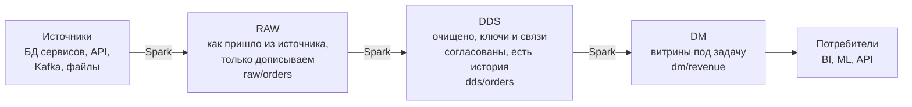

Airflow запускает каждый переход по расписанию и следит за порядком.

- **RAW** (иногда STG, staging) — данные ровно как пришли, только дописываем и ничего не исправляем. Нашли ошибку в логике очистки — всегда можно пересчитать из RAW.
- **ODS** (не всегда выделяют) — операционный слой, почти копия источника с минимальной чисткой.
- **DDS** (detail data store) — детальный очищенный слой: сущности из разных источников приведены к общим ключам, связи согласованы, хранится история. Часто моделируют по Data Vault или в третьей нормальной форме.
- **DM** (data marts, витрины, иногда CDM) — широкие денормализованные таблицы под конкретную задачу: выручка по дням и регионам, признаки для модели, таблица для API-сервиса.

> [!tip] Названия слоёв — соглашение команды
> В Databricks та же идея называется **medallion**: bronze ≈ RAW, silver ≈ DDS, gold ≈ DM. Если встретите любые из этих названий, суть одна: сырое → детальное → витрины.

## 10. Весь стек на одной схеме

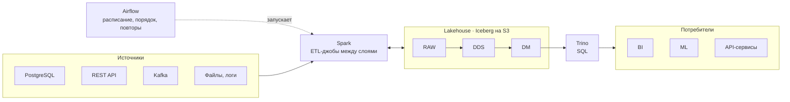

Путь одной записи:

1. Заказ появился в PostgreSQL сервиса заказов, курсы валют пришли из внешнего REST API, клики летят через Kafka, логи лежат файлами.
2. Ночью Airflow запускает DAG. Задачи выгружают данные из источников, Spark-джобы раскладывают их по слоям: сырые в RAW, очищенные в DDS, витрины в DM.
3. Всё это Iceberg-таблицы: Parquet-файлы на S3 плюс метаданные и каталог.
4. Дашборды, модели и API-сервисы забирают данные через Trino. ML-команды часто читают и напрямую через Spark.
5. Витрину часто отдают наружу через обычный REST-сервис на FastAPI. Вся эта махина в итоге заканчивается эндпоинтом `GET`, который возвращает JSON.

Где именно в этом стеке API, разбираем в следующем разделе.

## 11. API и стек больших данных

Стек больших данных — это тоже набор сервисов, которые общаются по HTTP и gRPC. Всё, что мы проходили про проектирование API, здесь применяется напрямую.

### Где в стеке живут API

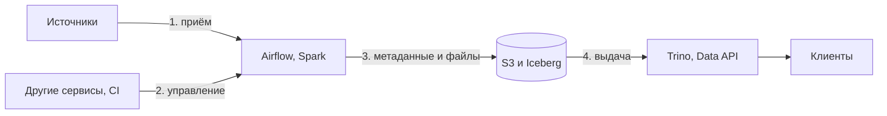

| Точка | Какие API | Зачем |
|---|---|---|
| 1. Приём | REST API источников, вебхуки, события в Kafka | данные заходят в RAW |
| 2. Управление | Airflow REST API, Spark Connect (gRPC), Kubernetes API | запускать пайплайны и следить за ними |
| 3. Метаданные и файлы | Iceberg REST Catalog, S3 API | движки договариваются о таблицах и читают файлы |
| 4. Выдача | Trino по HTTP и JDBC, Data API на FastAPI | витрины уходят к клиентам |

### 1. Приём: забрать данные из чужого API

Два режима:

- **pull** — задача Airflow по расписанию сама ходит в API источника;
- **push** — источник сам шлёт события в Kafka или на вебхук, дальше они ложатся в RAW.

Pull-задача, которая выгружает заказы за день:

```python
@task(retries=5)
def extract_orders(ds=None):
    url = f"{API}/v1/orders?updated_on={ds}"
    n = 0
    while url:
        r = client.get(url)          # httpx-клиент с повторами
        r.raise_for_status()
        s3.put_object(Bucket="raw",
            Key=f"orders/dt={ds}/page-{n}.json",
            Body=r.content)
        url, n = r.json().get("next"), n + 1
```

Здесь мы впервые оказываемся по другую сторону API: мы клиент, которому нужно выкачать много данных. Четыре правила:

- **Инкрементально.** Забираем только то, что изменилось за день. Для этого у API должен быть фильтр по дате изменения, иначе каждый день придётся выкачивать всё.
- **Курсор, а не offset.** Пока мы листаем страницы, данные в источнике меняются, и offset-пагинация теряет или дублирует строки. Ссылка `next` от сервера (курсор) к этому устойчива.

> [!example]- Как работает `next`
> Сервер отдаёт данные страницами и в каждом ответе кладёт ссылку на следующую:
> ```
> GET /v1/orders?updated_on=2026-11-08
> ← {"items": [ …1000 заказов… ],
>    "next": "/v1/orders?updated_on=2026-11-08&cursor=eyJpZCI6MTAwMH0"}
> ```
> `cursor` — закодированное «последний отданный id = 1000». На следующий запрос сервер выполняет `WHERE id > 1000 ORDER BY id LIMIT 1000`. На последней странице `next` равен `null`, и цикл заканчивается. `offset=1000` значит «пропусти первые 1000 строк»: если в начале списка удалили или добавили строку, всё сдвигается, и строка теряется или приходит дважды.
- **429 и Retry-After.** Хороший API честно отвечает `429 Too Many Requests` и говорит, сколько подождать. Хороший клиент ждёт и повторяет.
- **Сырой ответ в RAW.** Кладём JSON как пришёл, с детерминированными именами `page-0`, `page-1` в папке за дату. Повторный запуск перезапишет те же файлы, а не создаст дубли: та же идемпотентность, что и в Spark-джобе.

> [!tip] Вывод для тех, кто проектирует API
> Если ваши данные будут забирать в хранилище, дайте фильтр по дате изменения, курсорную пагинацию и честные 429.

### 2–3. Управление и метаданные: сам стек говорит по HTTP

| Сервис | Запрос | Что происходит |
|---|---|---|
| Airflow REST API | `POST /api/v2/dags/daily_revenue/dagRuns` | запустить пересчёт из другого сервиса или CI, потом смотреть статус запуска |
| Trino client protocol | `POST /v1/statement`, затем `GET nextUri` … | SQL в теле запроса, результат приходит частями: клиент ходит по ссылкам, пока они не кончатся |
| Iceberg REST Catalog | `POST /v1/{prefix}/namespaces/dds/tables/orders` | коммит нового снапшота; если кто-то успел раньше — `409 Conflict`, и движок повторяет попытку |
| S3 API | `GET /lake/…/001.parquet` с заголовком `Range` | движок читает файл кусками: сначала футер Parquet, потом только нужные колонки |

- **Airflow 3** даёт REST API версии v2. Им пользуется сам веб-интерфейс, и через него же другие системы запускают DAG. Например, сервис после загрузки нового прайса вызывает `POST dagRuns`, и витрина пересчитывается сразу, а не ночью.
- **Trino:** все клиенты (JDBC-драйвер, библиотека на Python, DBeaver) под капотом ходят по HTTP:
  1. `POST /v1/statement` с текстом SQL в теле. Trino не ждёт выполнения и сразу отвечает: `{"id": "…", "stats": {"state": "QUEUED"}, "nextUri": "…/1"}`.
  2. Клиент делает `GET nextUri`, в ответе очередная порция строк (`data`) и новый `nextUri`.
  3. Когда `nextUri` в ответе нет, запрос завершён (или упал с ошибкой).

  Пользователь этого не видит, он просто вызывает `cursor.fetchall()`. Это та же пагинация по ссылкам, что и в разделе про приём, плюс асинхронность: долгий запрос не держит одно HTTP-соединение.
- **Iceberg REST Catalog** — открытая спецификация в формате OpenAPI. Коммит, который мы разбирали в разделе 9, — это обычный HTTP-запрос: в теле требования («текущий снапшот должен быть 41») и изменения («добавить снапшот 42 и переключить на него ссылку»). Конфликт двух писателей — `409 Conflict`. Это оптимистичная блокировка через HTTP.
- **S3** — HTTP API для файлов. Метаданные Parquet лежат в конце файла, поэтому движок сначала запрашивает последние килобайты, узнаёт из футера, где лежат нужные колонки, и дальше запрашивает только эти байтовые диапазоны. Колоночный формат плюс `Range` — причина, по которой вычисления могут жить отдельно от хранилища.
- **Spark** можно вызывать удалённо: **Spark Connect** даёт тонкий клиент по gRPC, а driver работает на кластере. В Kubernetes Spark-джобы запускают через **Kubernetes API**.

### 4. Выдача: Data API

Витрину в слое DM нужно отдать фронтенду, партнёрам или другим сервисам. Давать им прямой доступ к Trino или к таблицам — плохая идея: клиенты завяжутся на внутреннюю схему, и любую перестройку хранилища придётся согласовывать со всеми. Поэтому перед витриной ставят **Data API** — обычный REST-сервис, например на FastAPI, с контрактом в OpenAPI, авторизацией, лимитами и кэшем.

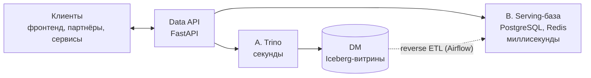

- **Вариант A:** сервис выполняет запрос в Trino по Iceberg-витрине. Ответ за секунды, подходит для внутренних аналитических API и небольшой нагрузки.
- **Вариант B:** Airflow после пересчёта выгружает витрину в быструю serving-базу (PostgreSQL, ClickHouse, Redis). Это называют **reverse ETL**. Ответ за миллисекунды, выдерживает продуктовый трафик.

Правила:

- **Не SQL наружу.** Клиент видит ресурсы и фильтры, а не таблицы и произвольный SQL.
- **ETag = id снапшота.** Пока Airflow не опубликовал новый снапшот витрины, данные не менялись, и клиент с заголовком `If-None-Match` получает `304 Not Modified`.
- **Узкие запросы.** Обязательные фильтры по дате или региону, лимит и курсорная пагинация, чтобы один клиент не мог выгрузить всю витрину одним запросом.

### Тяжёлый запрос: асинхронный API

Выгрузка за год может идти минуты или час. Синхронный HTTP-запрос столько не живёт: его оборвёт балансировщик по таймауту, а сервер будет держать соединение. Решение — асинхронный API:

```http
POST /v1/exports
{"mart": "revenue", "from": "2026-01-01"}
← 202 Accepted
  Location: /v1/exports/42

GET /v1/exports/42
← 200 {"status": "running"}

… через несколько минут …

GET /v1/exports/42
← 200 {"status": "done", "url": "https://s3…?X-Amz-Signature=…"}
```

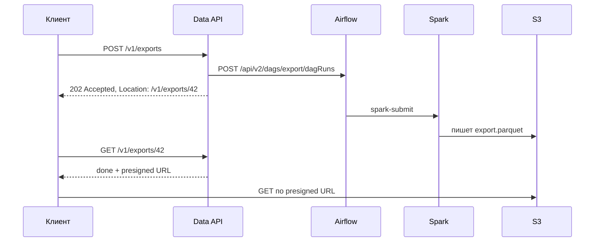

1. API сохраняет заявку и вызывает Airflow REST API, запускает DAG с параметрами выгрузки.
2. DAG запускает Spark-джоб, тот читает Iceberg-витрину и пишет результат в S3.
3. API отдаёт статус `done` и **presigned URL** — временную ссылку на файл с подписью в параметрах, которая работает ограниченное время.
4. Клиент качает гигабайты напрямую из S3, мимо нашего сервиса.

Вместо опроса статуса можно передать callback URL, и сервер вызовет вебхук, когда всё готово. Тот же паттерн «202 и опрос статуса» используют сами инструменты: Trino через `nextUri`, Airflow через статус DAG run, облачные сервисы вроде Athena и BigQuery.

## Шпаргалка

| Инструмент | Какую проблему решает |
|---|---|
| HDFS | хранить петабайты на дешёвых машинах и не терять данные |
| YARN | делить CPU и память кластера между задачами |
| MapReduce | считать параллельно рядом с данными |
| Hive и Metastore | SQL и схема поверх файлов |
| Parquet и партиции | читать только нужные колонки и дни |
| S3 | дёшево хранить данные отдельно от вычислений |
| Spark, PySpark | быстро считать в памяти, один API для SQL и Python |
| Trino | интерактивный SQL по озеру и другим источникам |
| Airflow | запускать цепочки задач по расписанию, с повторами |
| Iceberg, Lakehouse | транзакционные таблицы поверх озера для любых движков |
| Data API | отдать витрину наружу по стабильному контракту |

Цифры по умолчанию: блок HDFS 128 МБ, репликация 3, heartbeat DataNode каждые 3 с, Spark UI на порту 4040.

Словарь:

| Термин | Коротко |
|---|---|
| data locality | вычисления запускаются на узле, где лежат данные |
| реплика | копия блока HDFS на другом узле |
| shuffle | пересылка данных по сети по ключу между этапами |
| schema-on-read | схема применяется при чтении, а не при записи |
| predicate pushdown | движок пропускает куски файла, где точно нет нужных значений |
| партиция | папка с данными за один день или по другому ключу |
| трансформация / действие (Spark) | дописывает план / запускает выполнение |
| stage / task | часть job между shuffle / работа над одной партицией |
| MPP | параллельная обработка с потоковым обменом между узлами |
| федерация | один SQL-запрос по нескольким системам |
| DAG | направленный граф задач без циклов |
| logical date | дата интервала данных, за который идёт запуск |
| идемпотентность | повторный запуск даёт тот же результат |
| backfill | перезапуск пайплайна за прошлые даты |
| снапшот | версия таблицы: точный список её файлов |
| time travel | чтение таблицы на прошлый снапшот |
| copy-on-write / merge-on-read | способы изменить строки: переписать файл / дописать delete-файл |
| reverse ETL | выгрузка витрины из хранилища в быструю базу для продуктового API |
| presigned URL | временная подписанная ссылка на файл в S3 |
| 202 Accepted | «принял, но ещё не сделал»: ответ асинхронного API |
| RAW / DDS / DM | сырое / детальное очищенное / витрины |

> [!tip] Что брать на 50 ГБ?
> Скорее всего, ничего из этого стека: PostgreSQL или DuckDB справятся, и это нормально. Большие данные начинаются там, где перестаёт справляться одна машина.

## Вопросы для самопроверки

1. Почему 1 ТБ на одном диске читается около полутора часов, а на 100 дисках — около минуты? Какую идею Hadoop это обосновывает?
2. Чем scale up отличается от scale out? Назовите по одному плюсу и минусу каждого.
3. Что хранит NameNode, а что DataNode? Проходят ли данные через NameNode?
4. Файл 400 МБ записан в HDFS с настройками по умолчанию. Сколько блоков и сколько их копий окажется на кластере?
5. Что произойдёт, если один DataNode выключится навсегда?
6. Почему в HDFS плохо хранить миллион маленьких файлов?
7. Какой шаг MapReduce самый дорогой и почему? Что не так с цепочкой из десяти MapReduce-джобов?
8. Что хранит Hive Metastore? Что останется на диске после `DROP TABLE` для EXTERNAL-таблицы?
9. Почему запрос `SUM(amount)` по Parquet читает меньше данных, чем по CSV? Что такое predicate pushdown?
10. Spark заменяет Hadoop или его часть? Какие компоненты Hadoop Spark может использовать?
11. В каком месте Spark-кода начинается реальное чтение данных? Чем трансформация отличается от действия?
12. Почему `mode("overwrite")` и дата в пути делают джоб идемпотентным?
13. Как Trino выполняет запрос? Почему он отвечает быстрее Spark и почему долгие тяжёлые джобы всё же обычно гоняют на Spark?
14. Что такое федерация в Trino? Почему не стоит регулярно строить отчёты прямо по боевой базе сервиса?
15. Чем ETL отличается от ELT? Приведите пример E, T и L для сервиса заказов.
16. Что значит «Airflow — дирижёр, а не оркестр»? Почему не стоит передавать данные между задачами через XCom?
17. Запуск DAG с logical date 8 ноября: когда он фактически стартует и за какой день обрабатывает данные?
18. Из каких частей состоит Lakehouse и как в нём проходит запись новой порции данных?
19. Как устроено дерево метаданных Iceberg? Зачем нужна статистика min/max в манифестах?
20. Что происходит при UPDATE одной строки в Iceberg-таблице? Чем copy-on-write отличается от merge-on-read?
21. Где проходит граница между озером данных и Lakehouse? Можно ли построить Lakehouse на HDFS?
22. Что хранится в слоях RAW, DDS и DM? Почему RAW не исправляют?
23. Пройдите по финальной схеме путь одного заказа от PostgreSQL до ответа API. Какую проблему из раздела 2 решает каждый блок?
24. Назовите четыре точки, где стек больших данных использует API. Какие API в каждой?
25. Почему для регулярной выгрузки из чужого API важны фильтр по дате изменения и курсорная пагинация?
26. Как коммит в Iceberg выглядит на уровне HTTP? Что означает ответ 409?
27. Зачем ставить Data API перед витриной, а не дать клиентам доступ к Trino? Когда нужна serving-база?
28. Спроектируйте API выгрузки, которая идёт 40 минут: какие запросы, коды ответов и что происходит внутри стека?
