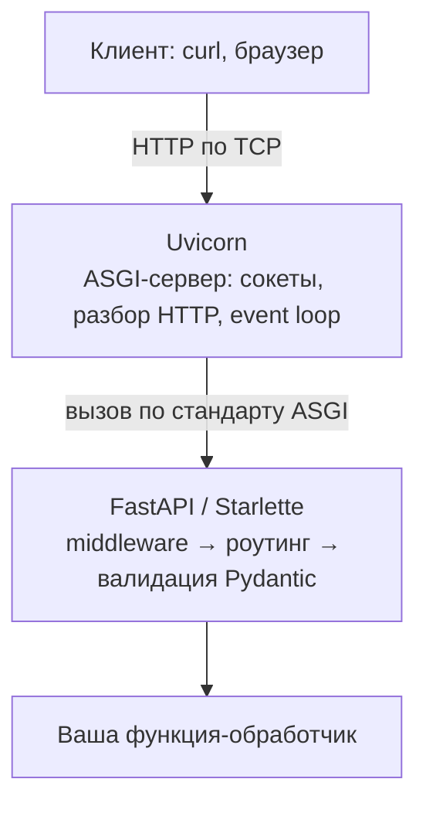
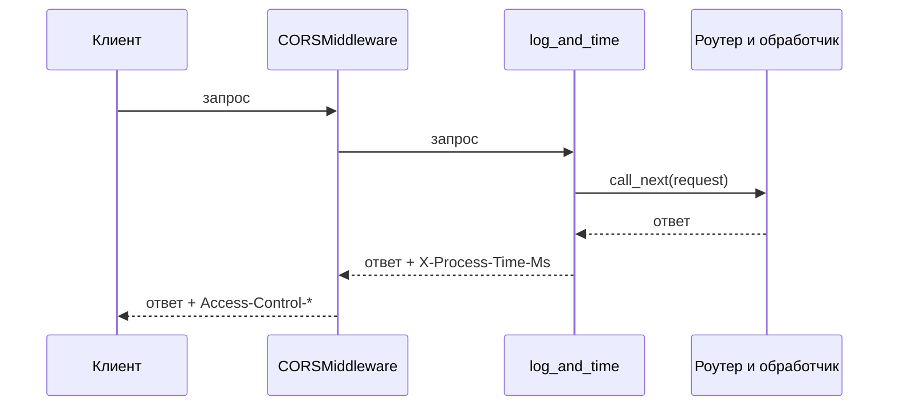
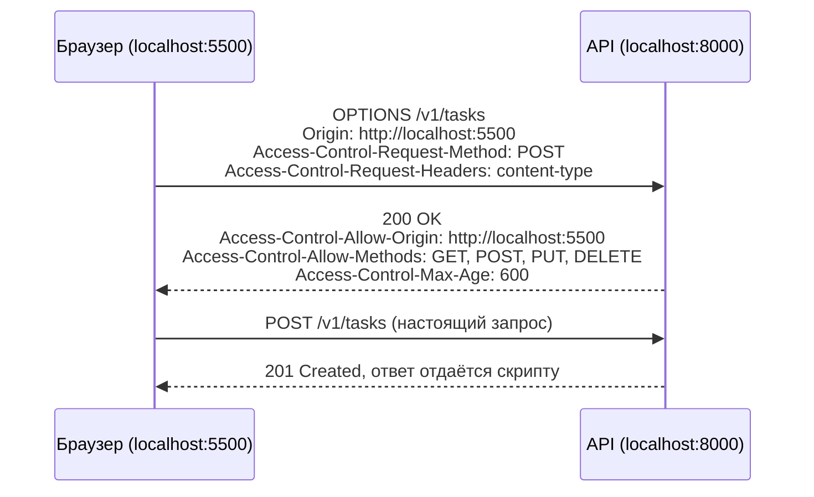

# Конспект лекции: REST API на FastAPI

Конспект повторяет лекцию в том порядке, в каком мы писали код.

> [!info] Код лекции
> Готовый код после каждого шага лежит в [репозитории курса](https://github.com/TheTonyPub/api-technologies-2026/tree/lecture/fastapi-intro/lectures/fastapi-intro/steps). Каждый шаг запускается отдельно командой `uvicorn main:app --reload` из своей папки.

- [[#1. REST: короткое напоминание]]
- [[#2. Как устроен Python-веб: WSGI, ASGI, Uvicorn, Starlette, FastAPI]]
- [[#3. Первое приложение]]
- [[#4. Параметры пути и запроса]]
- [[#5. Модели данных на Pydantic]]
- [[#6. CRUD и хранение в словаре]]
- [[#7. Роутеры]]
- [[#8. Middleware]]
- [[#9. CORS]]
- [[#10. Бонус: зависимости Depends]]
- [[#Шпаргалка]]
- [[#Вопросы для самопроверки]]

## 1. REST: короткое напоминание

REST-API строится вокруг **ресурсов**. Путь называет ресурс, HTTP-метод говорит, что с ним сделать.

| Метод | Путь | Действие | Успешный ответ |
|---|---|---|---|
| `POST` | `/v1/tasks` | создать задачу | `201 Created` и созданный объект |
| `GET` | `/v1/tasks` | список задач (с фильтрами в query) | `200 OK` |
| `GET` | `/v1/tasks/{task_id}` | одна задача | `200 OK` |
| `PUT` | `/v1/tasks/{task_id}` | изменить задачу | `200 OK` и новое состояние |
| `DELETE` | `/v1/tasks/{task_id}` | удалить задачу | `204 No Content` |

Свойства методов, о которых полезно помнить:

- `GET` **безопасный**: не меняет состояние сервера.
- `GET`, `PUT`, `DELETE` **идемпотентные**: повторный одинаковый запрос приводит к тому же состоянию. `POST` не идемпотентен: два одинаковых `POST` создадут две задачи.
- `PUT` по смыслу заменяет ресурс целиком, `PATCH` меняет его частично. На лекции для простоты мы делали частичное изменение через `PUT`.

Коды ответов:

| Код | Когда |
|---|---|
| `200 OK` | успех, в теле данные |
| `201 Created` | ресурс создан |
| `204 No Content` | успех без тела, например удаление |
| `404 Not Found` | ресурса нет |
| `422 Unprocessable Entity` | запрос синтаксически корректен, но данные не прошли валидацию (так отвечает FastAPI) |
| `5xx` | ошибка на сервере. Хороший API не отвечает 5xx на плохие данные клиента: это всегда 4xx |

Версия в пути (`/v1/...`) позволяет выпустить `/v2/...`, не ломая старых клиентов.

## 2. Как устроен Python-веб: WSGI, ASGI, Uvicorn, Starlette, FastAPI

Когда вы запускаете `uvicorn main:app`, работают несколько слоёв:



### WSGI и ASGI

Веб-серверу и веб-приложению нужен договор: как сервер передаёт приложению запрос и как получает ответ. В Python таких договоров два.

**WSGI** (Web Server Gateway Interface, 2003) — синхронный стандарт, на нём работают Flask и Django в классическом режиме. Приложение — это функция:

```python
def app(environ, start_response):
    start_response("200 OK", [("Content-Type", "text/plain")])
    return [b"Hello"]
```

Один запрос занимает один поток или процесс от начала до конца. Пока обработчик ждёт базу данных или другой сервис, поток простаивает. WebSocket и долгие соединения в WSGI не укладываются.

**ASGI** (Asynchronous Server Gateway Interface) — асинхронный наследник WSGI. Приложение — это корутина с тремя аргументами:

```python
async def app(scope, receive, send):
    # scope   — описание соединения: тип ("http", "websocket", "lifespan"), метод, путь, заголовки
    # receive — корутина, из которой приложение читает события (например, куски тела запроса)
    # send    — корутина, через которую приложение отправляет события ответа
    await send({"type": "http.response.start", "status": 200,
                "headers": [(b"content-type", b"text/plain")]})
    await send({"type": "http.response.body", "body": b"Hello"})
```

Это настоящее рабочее ASGI-приложение: его можно запустить через `uvicorn`. Что даёт ASGI:

- пока один запрос ждёт сеть (`await`), event loop обслуживает другие, поэтому один процесс держит тысячи одновременных соединений;
- кроме HTTP поддерживаются WebSocket и события жизненного цикла (`lifespan`: старт и остановка приложения).

### Uvicorn

**Uvicorn** — ASGI-сервер. Он слушает порт, разбирает HTTP-байты, собирает `scope` и вызывает ваше приложение. Сам FastAPI порт не открывает: без сервера он просто объект Python.

```sh
uvicorn main:app --reload                 # разработка: перезапуск при изменении кода
uvicorn main:app --host 0.0.0.0 --port 8000 --workers 4   # продакшен: несколько процессов
```

`main:app` читается как «из модуля `main.py` взять переменную `app`». `--reload` нужен только при разработке. `--workers` запускает несколько процессов, чтобы использовать несколько ядер CPU. Другие ASGI-серверы: Hypercorn, Granian. Gunicorn — менеджер процессов из мира WSGI, его иногда используют для запуска нескольких воркеров Uvicorn.

### Starlette

**Starlette** — лёгкий ASGI-фреймворк, на котором построен FastAPI. Буквально: `class FastAPI(Starlette)`. Всё, что касается HTTP, делает Starlette:

- объекты `Request` и `Response` (`JSONResponse`, `HTMLResponse`, `StreamingResponse`…);
- роутинг: сопоставление метода и пути с обработчиком;
- middleware, в том числе готовые `CORSMiddleware`, `GZipMiddleware`, `TrustedHostMiddleware`;
- WebSocket, фоновые задачи, статические файлы, `TestClient` для тестов.

Когда вы пишете `from fastapi import Request` или `from fastapi.middleware.cors import CORSMiddleware`, это реэкспорт из Starlette.

### FastAPI

**FastAPI** добавляет поверх Starlette три вещи:

1. **Валидацию и сериализацию через Pydantic.** По аннотациям типов FastAPI понимает, откуда взять каждый аргумент (путь, query, тело), приводит его к типу и проверяет. Ответ прогоняет через `response_model`.
2. **Генерацию OpenAPI.** Из тех же аннотаций строится контракт `/openapi.json` и интерактивная документация `/docs` (Swagger UI) и `/redoc`.
3. **Внедрение зависимостей** (`Depends`): общий код вроде пагинации, проверки токена или подключения к БД выносится в функции, которые FastAPI вызывает сам.

Итог: вы пишете функцию с типами, а разбор запроса, проверка данных, ответы 422 и документация получаются автоматически.

## 3. Первое приложение

Подготовка окружения:

```sh
python -m venv .venv
source .venv/bin/activate          # Windows: .venv\Scripts\Activate.ps1
pip install fastapi==0.116.1 uvicorn==0.35.0
```

`main.py`:

```python
from fastapi import FastAPI

app = FastAPI(title="Task Tracker", version="0.1.0")


@app.get("/")
async def root():
    return {"message": "Hello, FastAPI!"}


@app.get("/health")
def health() -> dict[str, str]:
    return {"status": "ok"}
```

Запуск: `uvicorn main:app --reload`, затем откройте http://localhost:8000/docs.

- Декоратор `@app.get(path)` связывает метод и путь с функцией. Есть `@app.post`, `@app.put`, `@app.patch`, `@app.delete`.
- Возвращённый `dict`, список или Pydantic-модель FastAPI превращает в JSON.

> [!warning] `async def` или `def`
> `async def` выполняется прямо в event loop. Обычный `def` FastAPI запускает в пуле потоков, чтобы он не блокировал остальные запросы. Правило: если внутри есть `await` (асинхронный драйвер БД, `httpx.AsyncClient`), пишите `async def`. Если вызываете блокирующий код (`requests`, `time.sleep`, синхронный драйвер БД), пишите `def`. **Блокирующий вызов внутри `async def` останавливает весь сервер.**

> [!example] Код шага
> [`steps/01_hello/main.py`](https://github.com/TheTonyPub/api-technologies-2026/blob/lecture/fastapi-intro/lectures/fastapi-intro/steps/01_hello/main.py)

## 4. Параметры пути и запроса

Данные приходят в запрос тремя путями: в пути, в query-строке после `?` и в теле. FastAPI решает, откуда брать аргумент, по простым правилам:

| Аргумент функции | Откуда берётся |
|---|---|
| имя есть в пути `{...}` | path-параметр |
| простой тип (`int`, `str`, `bool`…), имени нет в пути | query-параметр |
| Pydantic-модель | тело запроса (JSON) |

```python
@app.get("/hello/{name}")
async def hello(name: str, excited: bool = False):
    greeting = f"Привет, {name}"
    return {"greeting": greeting + ("!!!" if excited else ".")}
```

`GET /hello/anna?excited=true` вернёт `{"greeting": "Привет, anna!!!"}`. Для `bool` FastAPI понимает `true`, `1`, `yes`, `on`.

Аннотация типа означает и преобразование, и проверку:

```python
@app.get("/square/{number}")
async def square(number: int):
    return {"number": number, "square": number**2}
```

`/square/7` вернёт 49, а `/square/abc` вернёт 422 с телом:

```json
{"detail": [{"type": "int_parsing", "loc": ["path", "number"],
             "msg": "Input should be a valid integer, unable to parse string as an integer",
             "input": "abc"}]}
```

`loc` показывает, где ошибка (`path`, `query`, `body` и имя поля), `msg` объясняет, что не так.

Ограничения задаются через `Path` и `Query` внутри `Annotated`:

```python
from typing import Annotated, Optional
from fastapi import Path, Query


@app.get("/tasks/{task_id}")
async def get_task_stub(task_id: Annotated[int, Path(ge=1, description="ID задачи")]):
    return {"task_id": task_id}


@app.get("/search")
async def search(
    q: Annotated[str, Query(min_length=2, max_length=50)],    # обязательный
    limit: Annotated[int, Query(ge=1, le=100)] = 10,          # есть значение по умолчанию
    tag: Optional[str] = None,                                # необязательный
):
    return {"q": q, "limit": limit, "tag": tag}
```

Ограничения: числа `gt`, `ge`, `lt`, `le`; строки `min_length`, `max_length`, `pattern` (регулярное выражение). Все они попадают в схему OpenAPI и видны в `/docs`.

> [!example] Код шага
> [`steps/02_params/main.py`](https://github.com/TheTonyPub/api-technologies-2026/blob/lecture/fastapi-intro/lectures/fastapi-intro/steps/02_params/main.py)

## 5. Модели данных на Pydantic

Для тела запроса нужна **модель**: класс, наследник `pydantic.BaseModel`. Модель описывает форму данных, проверяет их и попадает в OpenAPI как schema.

```python
from datetime import datetime
from enum import Enum
from typing import Optional

from pydantic import BaseModel, Field


class Priority(str, Enum):
    LOW = "low"
    MEDIUM = "medium"
    HIGH = "high"


class TaskCreate(BaseModel):
    title: str = Field(min_length=3, max_length=100, examples=["Подготовить семинар"])
    description: Optional[str] = Field(default=None, max_length=1000, examples=["Слайды + live coding"])
    priority: Priority = Field(default=Priority.MEDIUM, examples=["high"])
    estimate_hours: float = Field(default=1.0, gt=0, le=40, examples=[2.5])


class TaskResponse(TaskCreate):
    task_id: int = Field(examples=[1])
    done: bool = False
    created_at: datetime


@app.post("/v1/tasks", response_model=TaskResponse, status_code=201)
async def create_task(payload: TaskCreate) -> TaskResponse:
    return TaskResponse(task_id=1, created_at=datetime.now(), **payload.model_dump())
```

Что здесь важно:

- **Поле без значения по умолчанию обязательно.** `title` обязателен, остальные поля нет.
- **`Field(...)`** задаёт ограничения (`min_length`, `gt`, `le` и т. д.), значение по умолчанию, описание и `examples`. Примеры Swagger подставляет в «Try it out», и по ним же генераторы клиентов и тестов строят запросы.
- **`Enum`** ограничивает значение списком. `"urgent"` вместо `"high"` даст 422, а в OpenAPI появится `enum: [low, medium, high]`.
- **Отдельные модели для запроса и ответа.** `TaskCreate` — то, что присылает клиент. `TaskResponse` — то, что отдаёт сервер, с серверными полями `task_id`, `done`, `created_at`. Клиент не может прислать свой `task_id`.
- **`response_model`** проверяет ответ и отсекает лишние поля, поэтому случайно отдать наружу, например, хеш пароля не получится. Модель ответа тоже попадает в документацию.
- **`status_code=201`** меняет код успешного ответа.
- **`model_dump()`** превращает модель в `dict`. `datetime` в JSON становится строкой ISO 8601.

Ошибки валидации приходят все сразу. Запрос `{"title": "ab", "priority": "urgent", "estimate_hours": 0}` вернёт 422 с тремя элементами в `detail`.

> [!example] Код шага
> [`steps/03_models/main.py`](https://github.com/TheTonyPub/api-technologies-2026/blob/lecture/fastapi-intro/lectures/fastapi-intro/steps/03_models/main.py)

## 6. CRUD и хранение в словаре

Хранилище — обычный словарь в памяти, ID выдаёт счётчик:

```python
from itertools import count

tasks: dict[int, TaskResponse] = {}
task_ids = count(start=1)
```

Данные живут, пока запущен процесс. Это нормально для учебного примера: API не зависит от того, где лежат данные, и словарь потом можно заменить на БД, не меняя эндпоинты.

### Создание и чтение

```python
from fastapi import HTTPException


def get_or_404(task_id: int) -> TaskResponse:
    task = tasks.get(task_id)
    if task is None:
        raise HTTPException(status_code=404, detail=f"Task {task_id} not found")
    return task


@app.post("/v1/tasks", response_model=TaskResponse, status_code=201)
async def create_task(payload: TaskCreate) -> TaskResponse:
    task = TaskResponse(task_id=next(task_ids), created_at=datetime.now(), **payload.model_dump())
    tasks[task.task_id] = task
    return task


@app.get("/v1/tasks/{task_id}", response_model=TaskResponse)
async def get_task(task_id: Annotated[int, Path(ge=1)]) -> TaskResponse:
    return get_or_404(task_id)
```

`HTTPException` можно выбросить из любой глубины кода, FastAPI превратит её в ответ `{"detail": "..."}` с нужным кодом.

### Список с фильтрами

```python
@app.get("/v1/tasks", response_model=list[TaskResponse])
async def list_tasks(
    done: Optional[bool] = None,
    priority: Optional[Priority] = None,
    limit: Annotated[int, Query(ge=1, le=100)] = 20,
) -> list[TaskResponse]:
    result = list(tasks.values())
    if done is not None:
        result = [t for t in result if t.done == done]
    if priority is not None:
        result = [t for t in result if t.priority == priority]
    return result[:limit]
```

`GET /v1/tasks?done=false&priority=high&limit=5`.

### Изменение и удаление

Для изменения нужна своя модель, где все поля необязательные, и валидатор уровня модели, который не пропускает пустое тело:

```python
from pydantic import model_validator


class TaskUpdate(BaseModel):
    title: Optional[str] = Field(default=None, min_length=3, max_length=100)
    description: Optional[str] = Field(default=None, max_length=1000)
    priority: Optional[Priority] = None
    estimate_hours: Optional[float] = Field(default=None, gt=0, le=40)
    done: Optional[bool] = None

    @model_validator(mode="after")
    def require_any_field(self) -> "TaskUpdate":
        if all(value is None for value in self.model_dump().values()):
            raise ValueError("Нужно передать хотя бы одно поле")
        return self


@app.put("/v1/tasks/{task_id}", response_model=TaskResponse)
async def update_task(task_id: Annotated[int, Path(ge=1)], payload: TaskUpdate) -> TaskResponse:
    task = get_or_404(task_id)
    updated = task.model_copy(update=payload.model_dump(exclude_none=True))
    tasks[task_id] = updated
    return updated


@app.delete("/v1/tasks/{task_id}", status_code=204, response_model=None)
async def delete_task(task_id: Annotated[int, Path(ge=1)]) -> None:
    get_or_404(task_id)
    del tasks[task_id]
```

- `model_validator(mode="after")` запускается после проверки отдельных полей и видит модель целиком. `ValueError` внутри превращается в 422.
- `model_dump(exclude_none=True)` берёт только переданные поля, `model_copy(update=...)` создаёт копию задачи с ними.
- Ответ 204 не имеет тела, поэтому `response_model=None`.

### Документирование ошибок

FastAPI сам документирует 200 и 422, а 404 нужно описать явно, иначе клиент не узнает о нём из контракта:

```python
class ErrorResponse(BaseModel):
    detail: str


NOT_FOUND = {404: {"model": ErrorResponse, "description": "Задача не найдена"}}


@app.get("/v1/tasks/{task_id}", response_model=TaskResponse, responses=NOT_FOUND)
```

### Проверка через curl

```sh
curl -X POST localhost:8000/v1/tasks -H "Content-Type: application/json" \
  -d '{"title": "Подготовить семинар", "priority": "high"}'          # 201
curl localhost:8000/v1/tasks/1                                       # 200
curl -i localhost:8000/v1/tasks/99                                   # 404
curl -X PUT localhost:8000/v1/tasks/1 -H "Content-Type: application/json" -d '{"done": true}'
curl -i -X PUT localhost:8000/v1/tasks/1 -H "Content-Type: application/json" -d '{}'   # 422
curl -i -X DELETE localhost:8000/v1/tasks/1                          # 204
```

> [!example] Код шага
> [`steps/04_crud/main.py`](https://github.com/TheTonyPub/api-technologies-2026/blob/lecture/fastapi-intro/lectures/fastapi-intro/steps/04_crud/main.py)

## 7. Роутеры

Когда ресурсов много, один файл становится неудобным. `APIRouter` — это «мини-приложение» со своим префиксом и тегами, которое подключается к `app`:

```text
main.py            ← создаёт app и подключает роутеры
schemas.py         ← Pydantic-модели
storage.py         ← хранилище
routers/system.py  ← /health
routers/tasks.py   ← /v1/tasks
```

```python
# routers/tasks.py
from fastapi import APIRouter

router = APIRouter(prefix="/v1/tasks", tags=["tasks"])


@router.post("", response_model=TaskResponse, status_code=201)
async def create_task(payload: TaskCreate) -> TaskResponse: ...


@router.get("/{task_id}", response_model=TaskResponse)
async def get_task(task_id: int) -> TaskResponse: ...
```

```python
# main.py
from fastapi import FastAPI
from routers import system, tasks

app = FastAPI(title="Task Tracker")
app.include_router(system.router)
app.include_router(tasks.router)
```

- `prefix` добавляется ко всем путям роутера, поэтому `@router.post("")` — это `POST /v1/tasks`.
- `tags` группируют эндпоинты в `/docs`.
- У `include_router` тоже есть `prefix`, `tags` и `dependencies`: так один роутер можно подключить, например, под `/v2` или навесить на него проверку токена.

> [!example] Код шага
> [`steps/05_routers`](https://github.com/TheTonyPub/api-technologies-2026/tree/lecture/fastapi-intro/lectures/fastapi-intro/steps/05_routers)

## 8. Middleware

**Middleware** — код, который оборачивает обработку **каждого** запроса. Его удобно представлять луковицей: запрос проходит слои снаружи внутрь, ответ возвращается изнутри наружу.



Так решают сквозные задачи, которые не хочется копировать в каждый эндпоинт: логирование, замер времени, request id, аутентификацию, сжатие, CORS, ограничение частоты запросов.

```python
import logging
import time
import uuid

from fastapi import Request

logger = logging.getLogger("task-tracker")


@app.middleware("http")
async def log_and_time(request: Request, call_next):
    request_id = request.headers.get("X-Request-ID", str(uuid.uuid4()))
    start = time.perf_counter()

    response = await call_next(request)      # передаём запрос дальше по цепочке

    elapsed_ms = (time.perf_counter() - start) * 1000
    response.headers["X-Request-ID"] = request_id
    response.headers["X-Process-Time-Ms"] = f"{elapsed_ms:.2f}"
    logger.info("%s %s -> %s (%.2f ms)", request.method, request.url.path,
                response.status_code, elapsed_ms)
    return response
```

- Код до `call_next` выполняется до обработчика: можно прочитать заголовки или сразу вернуть ответ (например, 401), не вызывая обработчик.
- Код после `call_next` работает с готовым ответом: можно добавить заголовки или записать лог.
- `HTTPException` (например, наш 404) уже превращена в обычный ответ к моменту, когда управление вернулось в middleware, поэтому в логе будет `-> 404`.
- **Порядок.** Каждый новый `add_middleware` или `@app.middleware` оборачивает все предыдущие, то есть middleware, добавленный последним, оказывается самым внешним и первым видит запрос.
- `@app.middleware("http")` — короткая запись для `BaseHTTPMiddleware` из Starlette. Для нагруженных сервисов и потоковых ответов пишут «чистый» ASGI-middleware (класс с методом `async __call__(self, scope, receive, send)`), он быстрее и не имеет ограничений `BaseHTTPMiddleware`.

Готовые middleware из Starlette: `CORSMiddleware`, `GZipMiddleware` (сжатие ответов), `TrustedHostMiddleware` (проверка заголовка `Host`), `HTTPSRedirectMiddleware`.

## 9. CORS

### Same-origin policy

**Origin** — это схема + хост + порт: `http://localhost:5500` и `http://localhost:8000` — разные origin, `http://` и `https://` тоже.

Браузер по умолчанию применяет **same-origin policy**: JavaScript со страницы одного origin не может читать ответы с другого. Это защищает пользователя: чужой сайт, открытый в соседней вкладке, не может от его имени прочитать данные из вашего API, куда пользователь залогинен.

**CORS** (Cross-Origin Resource Sharing) — способ, которым **сервер** говорит браузеру: «вот этим origin можно читать мои ответы». Делается это заголовками ответа `Access-Control-Allow-*`.

### Простые запросы и preflight

**Простой запрос** (`GET`, `HEAD`, `POST` с одним из `Content-Type`: `text/plain`, `application/x-www-form-urlencoded`, `multipart/form-data`, без своих заголовков) браузер отправляет сразу. Сервер его выполняет, а браузер смотрит на `Access-Control-Allow-Origin` в ответе и решает, отдать ли ответ скрипту.

Всё остальное, например `POST` с `Content-Type: application/json`, `PUT`, `DELETE` или запрос со своим заголовком `X-Request-ID`, требует **preflight**: сначала браузер спрашивает разрешения запросом `OPTIONS`.



Если на шаге 2 разрешения нет, настоящий запрос не отправляется вовсе, а в консоли браузера появляется `blocked by CORS policy`.

### CORSMiddleware

```python
from fastapi.middleware.cors import CORSMiddleware

app.add_middleware(
    CORSMiddleware,
    allow_origins=["http://localhost:5500", "http://127.0.0.1:5500"],
    allow_methods=["GET", "POST", "PUT", "DELETE"],
    allow_headers=["Content-Type", "X-Request-ID"],
    expose_headers=["X-Request-ID", "X-Process-Time-Ms"],
)
```

| Параметр | Что значит |
|---|---|
| `allow_origins` | список разрешённых origin. `["*"]` — любой |
| `allow_origin_regex` | то же регулярным выражением, например для всех поддоменов |
| `allow_methods` | какие методы разрешены в preflight |
| `allow_headers` | какие заголовки запроса разрешены |
| `expose_headers` | какие заголовки ответа JS сможет прочитать. Без этого скрипт видит только базовые (`Content-Type` и т. п.) |
| `allow_credentials` | разрешить cookie и `Authorization`. Несовместимо с `allow_origins=["*"]` |
| `max_age` | сколько секунд браузер кэширует ответ preflight (по умолчанию 600) |

> [!important] Что важно понимать про CORS
> - CORS защищает **пользователя в браузере**, а не ваш API. `curl`, Postman и другой бэкенд CORS не проверяют вообще. Аутентификацию CORS не заменяет.
> - Простой запрос с чужого origin сервер **выполнит**, браузер лишь не покажет скрипту ответ. Поэтому менять состояние через `GET` нельзя.
> - В продакшене перечисляйте конкретные домены фронтенда, а не `"*"`.

> [!tip] Демо на лекции
> [`cors-demo/index.html`](https://github.com/TheTonyPub/api-technologies-2026/blob/lecture/fastapi-intro/lectures/fastapi-intro/cors-demo/index.html). Запустите API на порту 8000, а страницу через `python -m http.server 5500` из папки `cors-demo`. Без `CORSMiddleware` в консоли будет ошибка CORS, хотя в логе Uvicorn запрос виден.

> [!example] Код шага
> [`steps/06_middleware_cors`](https://github.com/TheTonyPub/api-technologies-2026/tree/lecture/fastapi-intro/lectures/fastapi-intro/steps/06_middleware_cors)

## 10. Бонус: зависимости Depends

Зависимость — функция, результат которой FastAPI подставит в аргумент обработчика. У зависимости могут быть свои параметры (query, заголовки, другие зависимости), и они тоже валидируются и попадают в OpenAPI.

```python
from fastapi import Depends


class Pagination(BaseModel):
    limit: int
    offset: int


def pagination(
    limit: Annotated[int, Query(ge=1, le=100)] = 20,
    offset: Annotated[int, Query(ge=0)] = 0,
) -> Pagination:
    return Pagination(limit=limit, offset=offset)


@router.get("", response_model=list[TaskResponse])
async def list_tasks(page: Annotated[Pagination, Depends(pagination)]) -> list[TaskResponse]:
    return list(tasks.values())[page.offset : page.offset + page.limit]
```

Через тот же механизм делают проверку токена, получение текущего пользователя и сессию БД.

## Шпаргалка

| Задача | Как |
|---|---|
| запустить | `uvicorn main:app --reload` |
| документация | `/docs`, `/redoc`, `/openapi.json` |
| path-параметр | `@app.get("/items/{item_id}")` + `item_id: int` |
| query-параметр | аргумент простого типа, которого нет в пути |
| ограничения параметра | `Annotated[int, Query(ge=1, le=100)]`, `Path(ge=1)` |
| тело запроса | аргумент с типом `BaseModel` |
| ограничения поля | `Field(min_length=..., gt=..., pattern=..., examples=[...])` |
| проверка нескольких полей | `@model_validator(mode="after")` |
| модель ответа | `response_model=...` или аннотация `-> Model` |
| код успеха | `status_code=201` |
| ошибка | `raise HTTPException(status_code=404, detail="...")` |
| описать ошибку в OpenAPI | `responses={404: {"model": ErrorResponse}}` |
| разбить на модули | `APIRouter(prefix=..., tags=[...])` + `app.include_router(...)` |
| код вокруг каждого запроса | `@app.middleware("http")` |
| доступ из браузера | `app.add_middleware(CORSMiddleware, allow_origins=[...])` |
| общий код для эндпоинтов | `Depends(...)` |

## Вопросы для самопроверки

Ответ спрятан под вопросом: нажмите, чтобы раскрыть.

> [!question]- Чем ASGI отличается от WSGI и что это даёт сервису, который много ждёт сеть?
> WSGI синхронный: один запрос занимает поток целиком, пока ждёт сеть или БД. ASGI асинхронный: пока запрос ждёт `await`, event loop обслуживает другие, поэтому один процесс держит тысячи соединений. Плюс ASGI поддерживает WebSocket и lifespan.

> [!question]- Что делает Uvicorn, а что FastAPI? Почему нельзя запустить FastAPI без сервера?
> Uvicorn слушает порт, разбирает HTTP и вызывает приложение по стандарту ASGI. FastAPI — само приложение: роутинг, валидация, ответ. Без сервера FastAPI — просто объект Python, который никто не вызывает.

> [!question]- Какую часть работы FastAPI делегирует Starlette, а какую Pydantic?
> Starlette: Request/Response, роутинг, middleware, WebSocket, TestClient. Pydantic: описание моделей, валидация и сериализация данных. FastAPI связывает их и добавляет OpenAPI и `Depends`.

> [!question]- Как FastAPI понимает, что аргумент функции нужно взять из пути, из query или из тела?
> Имя есть в шаблоне пути → path-параметр. Pydantic-модель → тело запроса. Простой тип, которого нет в пути → query-параметр. Явно можно указать через `Path`, `Query`, `Body`, `Header`.

> [!question]- Когда стоит писать обработчик через `def`, а когда через `async def`?
> `async def` — если внутри есть `await` на асинхронные операции. `def` — если вызывается блокирующий код: FastAPI запустит его в пуле потоков, и он не остановит event loop.

> [!question]- Зачем разделять `TaskCreate` и `TaskResponse`? Что делает `response_model`?
> Клиент не должен задавать серверные поля (`task_id`, `created_at`), а ответ не должен отдавать лишнее. `response_model` проверяет ответ, отсекает лишние поля и описывает схему ответа в OpenAPI.

> [!question]- Почему на невалидное тело FastAPI отвечает 422, и почему сервис не должен отвечать на него 500?
> Запрос синтаксически корректен, но данные не прошли проверку — это 422 Unprocessable Entity. 5xx означает ошибку сервера; на плохие данные клиента сервер обязан отвечать 4xx, иначе валидация описана не полностью.

> [!question]- В каком порядке выполняются два middleware, добавленные один за другим?
> Middleware, добавленный последним, — самый внешний: он первым видит запрос и последним — ответ.

> [!question]- Почему запрос из `curl` проходит, а тот же запрос из JS на другой странице блокируется? Кто именно его блокирует?
> CORS проверяет браузер, а не сервер. `curl` его не соблюдает. Браузер блокирует скрипту доступ к ответу с другого origin, если сервер не разрешил его заголовками `Access-Control-Allow-*`.

> [!question]- Что такое preflight-запрос и когда браузер его отправляет?
> Предварительный запрос `OPTIONS`, которым браузер спрашивает разрешения. Отправляется для «непростых» запросов: методы кроме GET/HEAD/POST, `Content-Type: application/json`, собственные заголовки.
